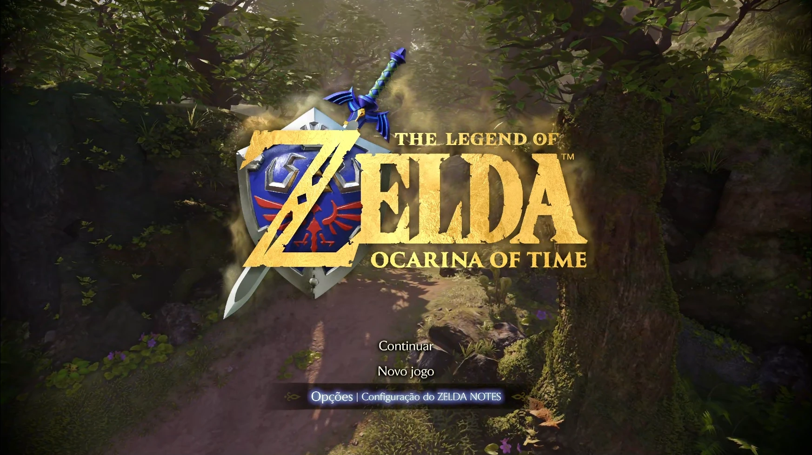
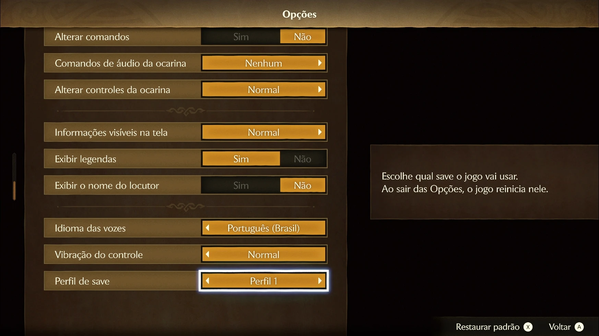

# zelda-oot-perfis: perfis de save para Ocarina of Time (Switch 2)

*[Read in English](README.md)*

Mod para **The Legend of Zelda: Ocarina of Time** do Switch 2 que adiciona **perfis de save
dentro do jogo**. O jogo só tem um save por usuário. O mod adiciona a linha **"Perfil de save"**
na tela de **Opções** do próprio jogo, com Perfil 1 a Perfil 9. Cada perfil é um jogo separado,
com progresso, configurações e dados de conta próprios.

| 1. Tela inicial → **Opções** | 2. Última linha: **Perfil de save** |
|---|---|
|  |  |

- **Jogo:** `0400486024DEC000`, atualização v131072 (**1.1.1**). Em outra versão o mod não faz
  nada e o jogo roda normal.
- **Emulador:** Fritchii (família Lichii / Eden). Testado no Fritchii 5.8.4.
- **Versão:** 1.0.0.

## Instalar

1. Baixe o `zelda-oot-perfis-v1.0.0.zip`.
2. No emulador, clique com o botão direito no jogo na lista e escolha
   **Open Mod Data Location**. Na interface em português o nome pode estar traduzido, algo como
   "Abrir local dos dados de mods". Abre uma pasta, por exemplo
   `%APPDATA%\fritchii\load\0400486024DEC000\`.
3. Extraia o zip **dentro dessa pasta**. Tem que ficar
   `...\0400486024DEC000\zelda-oot-perfis\exefs\`, com dois arquivos dentro: `subsdk9` e
   `E0F3CCFAF50065AE4EA01EB5AEB13B1A45DA3348.ips`.
4. Abra o jogo. Em **Propriedades → Add-Ons** do jogo, o `zelda-oot-perfis` deve aparecer
   marcado.

Para desinstalar, apague a pasta `zelda-oot-perfis` ou desmarque o mod em Add-Ons. Os saves
continuam onde estão.

> **Faça backup do seu save antes.** O Perfil 1 nunca sai do lugar e o mod foi testado com
> cuidado num save de verdade, mas é um mod. O save fica na pasta de dados do emulador, em
> `nand\user\save\0000000000000000\<usuário>\0400486024DEC000\`.

## Como usar

1. Abra **Opções**, pela tela inicial ou pelo menu de pausa, e desça até a última linha,
   **Perfil de save**.
2. Escolha o perfil com as setas.
   - **Na tela inicial** (antes de Continuar / Novo jogo): ao sair das Opções, o jogo
     **reinicia sozinho** já no perfil escolhido.
   - **Dentro de um jogo**: nada reinicia, para não perder progresso que ainda não foi salvo.
     A troca vale na próxima vez que o jogo abrir.

   A descrição embaixo da linha diz qual dos dois vai acontecer.
3. **O Perfil 1 é o seu save de sempre**, no lugar original, sem nenhuma mudança. Os outros
   perfis começam vazios: escolha **Novo jogo**. Eles ficam nas pastas `perfil2/` … `perfil9/`
   dentro do save do jogo.

Os textos seguem o idioma do jogo. São 13 idiomas: português, inglês, espanhol, francês,
alemão, italiano, holandês, polonês, russo, japonês, coreano e chinês simplificado e tradicional.
Um idioma desconhecido mostra o texto em inglês.

### Reservas

- **L + R + direcional para baixo**, em qualquer tela, abre um painel do mod com a mesma lista
  de perfis. Serve para o caso de a linha nas Opções parar de funcionar, por exemplo depois de
  uma atualização do jogo.
- O perfil fica gravado como um dígito em `perfil_ativo.txt`, no save do jogo. Dá para editar à
  mão, com o emulador fechado.

## Limitações conhecidas

- Só a versão **1.1.1** do jogo é suportada. O patch é preso a esse build, e em outra versão o
  mod fica desligado.
- Não funciona junto com outros mods que também trazem um módulo `exefs/subsdk9`, como os
  baseados no sloperina: o emulador carrega só um `subsdk9`. Mods que só mudam texturas,
  modelos ou textos (`romfs`) funcionam junto.
- Ao fechar o jogo, o log do emulador pode mostrar um "Userspace PANIC". Isso também acontece
  quando o emulador força a parada do jogo, e os saves já estão gravados nessa hora.

## Como funciona

- **`subsdk9`** é um módulo de código que o jogo carrega sozinho (como no
  [sloperina](https://github.com/PracticeROM/sloperina)). Ele intercepta as funções de arquivo
  do jogo (`nn::fs`) e redireciona os caminhos do save: `slot_00/progress.sav` vira
  `perfil2/slot_00/progress.sav`. Se alguma interceptação falhar, os perfis ficam desligados, e
  o mod nunca grava no lugar errado.
- **`<build id>.ips`** desvia 7 funções internas do jogo para o módulo:
  - a lista e os botões das Opções, que ganham a linha nova;
  - a busca de mensagens, que fornece os textos da linha;
  - o fechamento da tela, que dispara o reinício.

  Cada desvio é conferido antes de ser usado. A linha usa um tipo de opção que existe no jogo
  mas nunca é usado, então nenhuma configuração real do `option.sav` é alterada.
- **O reinício** é o do próprio sistema (`nn::oe::RestartProgram`). A memória volta limpa, então
  nada de um perfil vaza para outro.

Os detalhes técnicos, com endereços e estruturas, estão em
[`docs/investigacao.md`](docs/investigacao.md).

## Compilar

Precisa do devkitPro (devkitA64) e do Python 3.

```
make dist PYTHON=python3                 # gera dist/load/0400486024DEC000/zelda-oot-perfis/exefs/
make test HOSTCC=cc                      # roda no PC os testes da lógica pura
powershell -File tools\empacotar.ps1     # gera os zips de distribuição
```

Para desenvolver, `tools/instalar-mod.ps1` instala direto do `dist/`, com backup dos saves
antes, e `-Diagnostico` liga as mensagens do mod no log do emulador.

## Apoie o projeto

Se você curtiu o mod e quiser agradecer, pode me pagar um café pelo
**[Ko-fi](https://ko-fi.com/juvxncio)** ou por PIX, com a chave aleatória
`e13ef68b-2589-40fb-94c4-56fce7e0d37c`. É totalmente opcional: o mod é e vai continuar grátis.

## Créditos e licenças

- Código sob GPL-3.0 (`LICENSE`). Partes adaptadas do
  [sloperina](https://github.com/PracticeROM/sloperina), também GPL-3.0: o cabeçalho do módulo,
  os ganchos na GOT e a técnica do patch IPS.
- O painel de reserva usa a fonte Press Start 2P, SIL Open Font License 1.1
  (`mod/font-OFL.txt`).
- Pesquisa da comunidade: [oot-remake-modding](https://github.com/Kabosune/oot-remake-modding)
  e [Hookshot](https://github.com/NotRexed/Hookshot).
